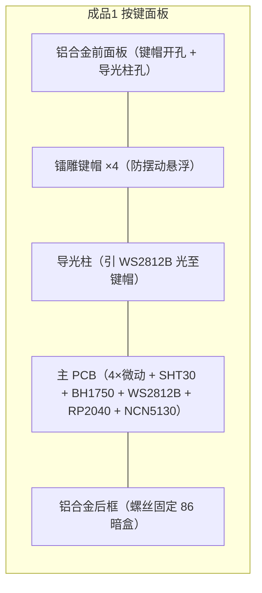
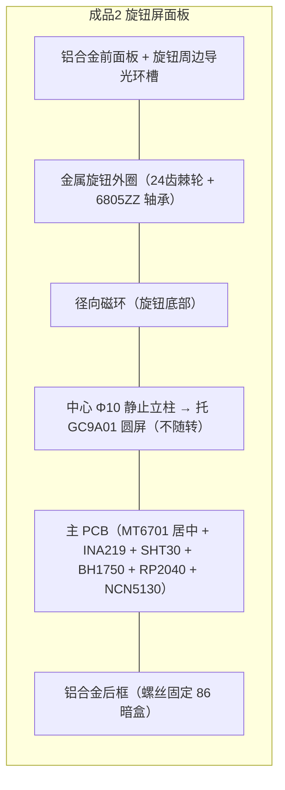
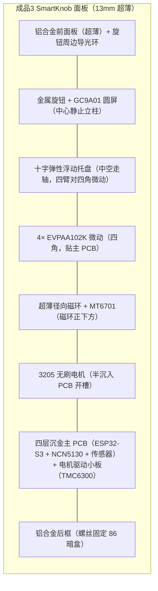
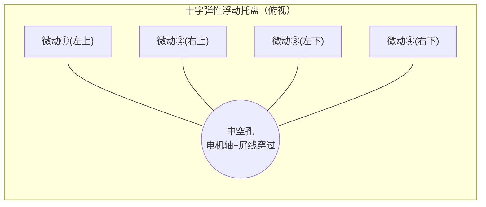
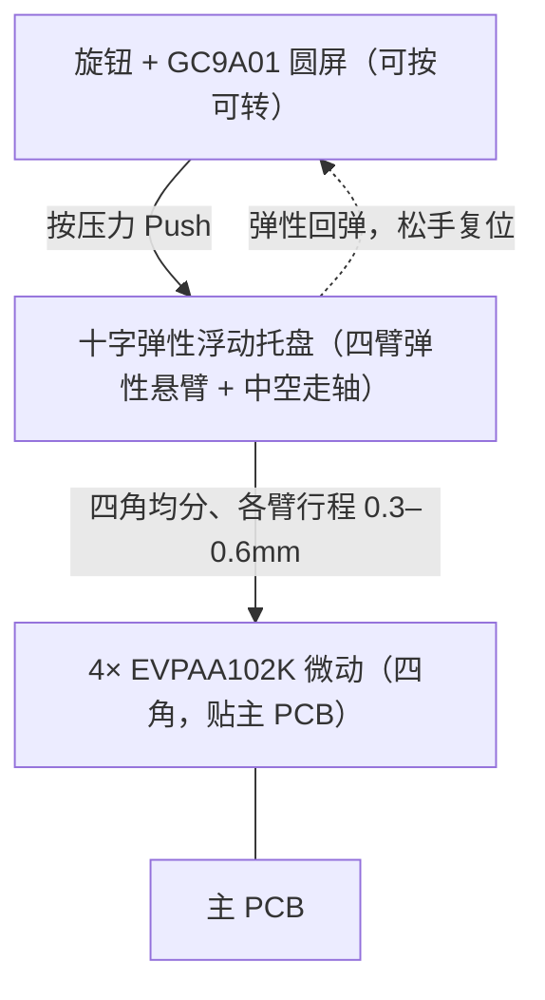
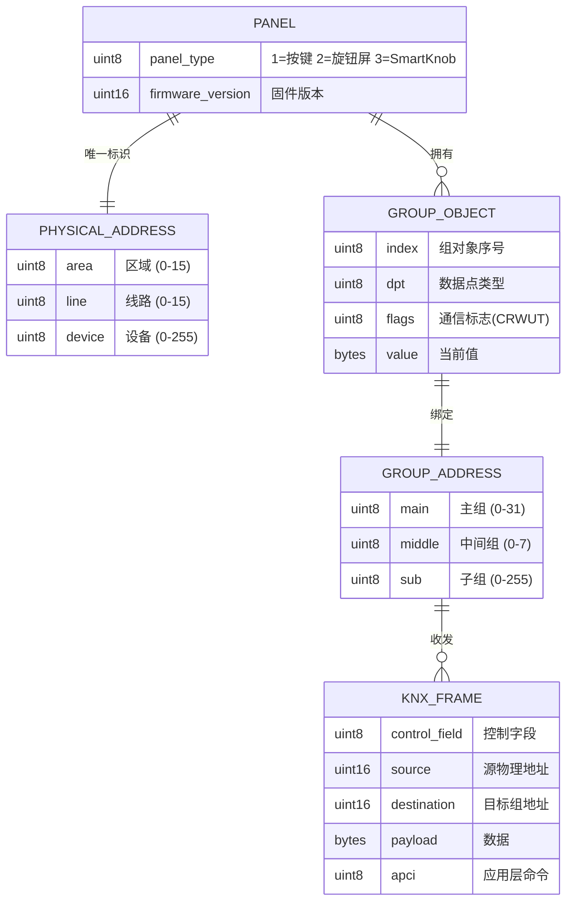
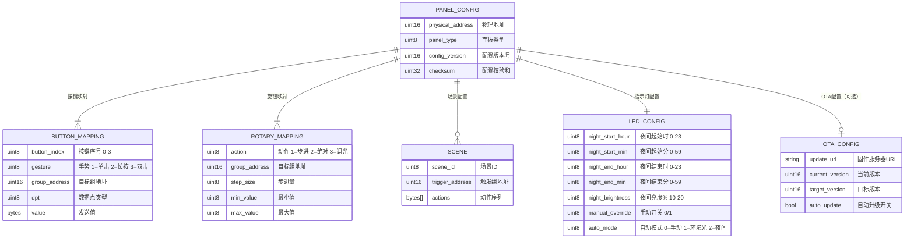

# 设计文档：KNX 智能面板系统

## Overview

本项目设计一套可复刻的 DIY KNX 智能面板系统，包含三种面板类型，全部接入 KNX 总线以控制 DALI 灯光及 KNX 总线设备。系统目标是在 5 房 2 厅 3 卫住宅场景下，以远低于认证厂家面板（¥3,000–6,000/台）的成本实现更优的交互体验，并保证可复刻性、知识产权合规与统一安装规范。

三种面板类型：

| 面板类型 | 代号 | 核心交互 | 主控 |
| :--- | :--- | :--- | :--- |
| 纯按键面板 | 成品1 | 4 路物理按键 + RGB 指示灯 + 室温上报 | RP2040 |
| 机械棘轮旋钮屏面板 | 成品2 | 24 齿机械棘轮旋钮 + 1.28" 圆屏 + 功耗表盘 | RP2040 |
| SmartKnob 可调阻尼旋钮面板 | 成品3 | 无刷电机 FOC 可调阻尼旋钮 + 圆屏 + 双维操控 | ESP32-S3（单芯：KNX + FOC + UI） |

本设计的核心架构决策是 **独立 PCB 设计**：每种面板使用自己独立的 PCB，将 KNX 总线取电、收发电路、主控 MCU 与输入交互组件全部集成在一块 PCB 上。成品1 和成品2 各使用一块 PCB；成品3 视空间需求可使用主 PCB + 电机驱动小板的双板结构。三种面板仍然保持统一的安装尺寸与接线接口规范（需求 7），通过统一机械接口规范保证互换性。

### 设计目标与约束

本设计需同时满足以下关键约束（来自需求文档）：

- **成本**：元器件成本阶梯式上限（按键最低、旋钮屏居中、SmartKnob 最高），基于当前BOM工程估算（含金属外框 CNC，核算日 2026-10-29）按键 ≈¥165 / 旋钮屏 ≈¥265 / SmartKnob ≈¥400，留裕量后目标上限 ¥180 / ¥280 / ¥450；批量 100 套以上单套造价目标 按键 ¥150 / 旋钮屏 ¥240 / SmartKnob ¥400（BOM 定稿后以实采价复核更新）。三者仍远低于认证厂家面板（¥3,000–6,000/台）
- **KNX 合规**：收发标准帧、ETS 物理地址分配与组地址绑定、仅靠总线电压供电运行
- **统一安装**：兼容标准 86 型暗盒，三种面板安装尺寸与接线接口完全一致，可互换更换
- **OTA 升级（可选）**：非强制功能。RP2040 无网络能力，使用 USB UF2 手动更新；ESP32-S3 有 WiFi 能力，可选启用原生 OTA
- **使用寿命**：0–40°C / 10–90% RH 下 ≥10 年，按键/旋钮 ≥10 万次机械寿命；器件/材料选型按10年寿命同步校核（长寿命电解电容、工业/车规无源件、耐候表面处理、轴承/机械件额定循环覆盖10年）
- **交互易用性**：三步内完成设置，1s 内操作反馈，菜单层级 ≤2 层，三种面板交互逻辑一致
- **复刻性**：完整 BOM、PCB 文件、组装说明、固件烧录与调试文档

### 关键技术决策

本设计涉及若干需要明确取舍的关键技术决策。以下列出决策要点与理由，详细论证见后续各节。

| 决策 | 选择 | 理由与权衡 |
| :--- | :--- | :--- |
| 架构方案 | 独立 PCB 设计（每面板一块 PCB） | 每面板独立设计，集成 KNX 收发与主控于单板，简化设计与组装，降低连接器故障风险。统一安装尺寸与接线规范通过机械接口规范保证，满足需求 7 互换性。成品3 可视情况增加电机驱动小板 |
| 主控 | 成品1/2：RP2040 + NCN5130；成品3：ESP32-S3 + NCN5130（单芯） | RP2040 是 OpenKNX 官方参考平台之一；成品3 取消 RP2040 桥接核，由 ESP32-S3 直接驱动 NCN5130 运行 KNX 栈（OpenKNX/thelsing-knx 均原生支持 ESP32 + NCN5130），双核中 Core0 跑 KNX 收发 + UI、Core1 独占 FOC 实时环，减少一颗 MCU、省去板间 UART 中继与一处故障点。NCN5120 已停产（EOL），不选 |
| OTA | 非强制，按 MCU 能力可选 | RP2040 无网络能力，使用 USB UF2 手动更新固件；ESP32-S3 有 WiFi 能力，可选启用原生 OTA。不引入额外的 WiFi 伴随 MCU |
| 配置接口 | USB 串口 / KNX 总线 | 不依赖 WiFi 伴随 MCU，管理员通过主控（成品1/2 为 RP2040、成品3 为 ESP32-S3）的 USB 串口统一管理配置，降低硬件成本与复杂度 |
| 旋钮角度检测 | 径向磁环 + MT6701CT 非接触磁编码（成品2/3 共用） | 消除 EC11 机械磨损，成品2/3 共用同一物料与 SPI CRC-6 驱动，降低 BOM 复杂度 |
| FOC 控制栈 | ESP32-S3 + SimpleFOC 库 + TMC6300 驱动 | SimpleFOC 开源成熟，电压模式 FOC 满足可调阻尼需求；TMC6300 低压 5V 母线降低发热 |
| UI 框架 | LVGL（RP2040 用 arduino-pico SPI/DMA，ESP32-S3 用 esp_lcd） | 统一图形栈，不引入竞争的 TFT_eSPI；圆屏 GC9A01 |
| 结构减薄 | 取消锂电池 + 电机半沉入 + 超薄磁环 | 成品3 从 38mm 减至 13mm，适配 86 暗盒 |

## Architecture

### 系统总体架构

系统采用独立 PCB 设计，三种面板各自独立，每块 PCB 集成 KNX 总线取电、收发电路、主控 MCU 与输入交互组件。三种面板遵循统一的安装尺寸与接线接口规范，保证互换性。

```mermaid
flowchart TB
    BUS["KNX TP1 总线（29V / 9600bps）"]

    subgraph P1["成品1：按键面板（独立 PCB）"]
        direction TB
        P1_MCU["RP2040 主控<br/>OpenKNX + 应用逻辑 + 配置管理(USB串口)"]
        P1_KNX["NCN5130 KNX 收发 + 总线取电"]
        P1_IN["4×静音微动 + SHT30 温湿度"]
        P1_LED["WS2812B RGB 指示灯"]
        P1_FLASH["W25Q16 外部 Flash<br/>固件 + 配置存储"]
        P1_MCU --- P1_KNX
        P1_MCU --- P1_IN
        P1_MCU --- P1_LED
        P1_MCU --- P1_FLASH
    end

    subgraph P2["成品2：旋钮屏面板（独立 PCB）"]
        direction TB
        P2_MCU["RP2040 主控<br/>OpenKNX + 应用逻辑 + 配置管理(USB串口) + LVGL UI"]
        P2_KNX["NCN5130 KNX 收发 + 总线取电"]
        P2_IN["24齿机械棘轮 + MT6701 磁编码 + INA219 + SHT30"]
        P2_DISP["GC9A01 1.28圆屏 + WS2812B"]
        P2_FLASH["W25Q16 外部 Flash<br/>固件 + 配置存储"]
        P2_MCU --- P2_KNX
        P2_MCU --- P2_IN
        P2_MCU --- P2_DISP
        P2_MCU --- P2_FLASH
    end

    subgraph P3["成品3：SmartKnob 面板（独立 PCB）"]
        direction TB
        P3_MCU["ESP32-S3 单芯主控<br/>Core0: OpenKNX + 配置管理(USB串口) + LVGL UI<br/>Core1: SimpleFOC 实时环 + (可选)WiFi OTA"]
        P3_KNX["NCN5130 KNX 收发 + 总线取电"]
        P3_FOC["TMC6300 + 3205无刷电机 + MT6701"]
        P3_DISP["GC9A01圆屏 + 传感器 + 超级电容"]
        P3_FLASH["W25Q16 外部 Flash<br/>配置存储（固件在 ESP32-S3 内置 Flash）"]
        P3_MCU --- P3_KNX
        P3_MCU --- P3_FLASH
        P3_MCU --- P3_FOC
        P3_MCU --- P3_DISP
    end

    BUS -- "总线取电 + KNX标准帧" --> P1_KNX
    BUS -- "总线取电 + KNX标准帧" --> P2_KNX
    BUS -- "总线取电 + KNX标准帧" --> P3_KNX
```

### 固件分层架构

```mermaid
flowchart TB
    subgraph RP2040_FW["RP2040 固件（成品1/2 主控）"]
        direction TB
        KNX["OpenKNX 协议栈<br/>NCN5130 驱动 / 帧收发 / 组对象"]
        HAL["硬件抽象层<br/>GPIO/PIO/I2C/SPI 驱动"]
        APP["应用逻辑层<br/>按键/旋钮事件映射 / 场景管理 / 指示灯控制"]
        CFG["配置管理层<br/>USB串口接口 / 参数持久化 / 导入导出 / 校验"]
        UI2["UI 层（成品2）<br/>LVGL + arduino-pico SPI/DMA"]
    end
    subgraph ESP32S3_FW["ESP32-S3 固件（成品3 单芯：KNX + FOC + UI）"]
        direction TB
        KNX3["OpenKNX 协议栈<br/>NCN5130 驱动 / 帧收发 / 组对象（Core0）"]
        CFG3["配置管理层<br/>USB串口 / 持久化 / 导入导出 / 校验（Core0）"]
        FOC["FOC 控制环<br/>SimpleFOC / 电压模式 / 阻尼计算 / Taptic（Core1 独占）"]
        UI3["UI 层<br/>LVGL + esp_lcd / GC9A01（Core0）"]
        OTA_OPT["（可选）OTA 服务<br/>WiFi 下载 / 原生双分区回滚"]
    end
```

### 职责隔离原则

三种面板的实时性需求不同，但统一遵循"实时任务与非实时任务隔离"原则：

- **KNX 总线收发**（9600bps，对时序敏感）在成品1/2 由 RP2040 + NCN5130 承担；在成品3 由 ESP32-S3 的 **Core0** 驱动 NCN5130 承担，与 UI 同核但均为事件驱动、非硬实时，FOC 实时环隔离在 Core1，不互相抢占。这直接支持需求 6.2（升级期间保持总线连接不中断，仅在启用 OTA 时适用）。
- **配置管理**通过主控 USB 串口进行（非实时，仅管理员会话期间），不影响 KNX 实时收发。需求 9.1 的"同一接口"即主控 USB 串口提供的统一命令行配置接口。
- **FOC 实时环**（成品3）由 ESP32-S3 **Core1 独占**（~6.8kHz loopFOC），Core0 跑 KNX + UI，实现 <16ms 切页与稳定控制环。取消 RP2040 桥接后，KNX 接收中断与 FOC 环分处两核，用 FreeRTOS 核绑定（`xTaskCreatePinnedToCore`）与中断亲和保证 FOC 环不被 KNX/UI 抖动打断；NCN5130 的收发缓冲与扩展帧缓存进一步吸收 Core0 的瞬时占用。

### 三面板差异化处理

| 维度 | 成品1 按键面板 | 成品2 旋钮屏面板 | 成品3 SmartKnob 面板 |
| :--- | :--- | :--- | :--- |
| 主控 | RP2040（单芯） | RP2040（单芯） | ESP32-S3（单芯，双核分工） |
| PCB | 单板集成 | 单板集成 | 单板集成（或主+电机驱动小板） |
| KNX 收发 | NCN5130（板载） | NCN5130（板载） | NCN5130（板载，ESP32-S3 直驱） |
| 输入 | 4×微动 + RC 消抖 | 24齿机械棘轮 + MT6701磁编码 | 3205无刷电机 + MT6701 + 4×微动 |
| 反馈 | RGB 指示灯 + 机械回弹 | 圆屏显示 + 机械段落感+听觉 | 圆屏 + FOC可调阻尼 + Taptic电磁脉冲 |
| 显示 | 无 | GC9A01 1.28"圆屏 | GC9A01 1.28"圆屏 |
| 传感 | SHT30 + 环境光 | SHT30 + INA219 功耗 + 环境光 | SHT30 + INA219 + 环境光 |
| 固件更新 | USB UF2（手动） | USB UF2（手动） | ESP32-S3: USB 串口烧录 / 可选WiFi OTA |
| 配置接口 | USB串口 / KNX总线 | USB串口 / KNX总线 | USB串口 / KNX总线 |
| 板厚 | 标准 | 标准 | 13mm 超薄（四层沉金） |

## Components and Interfaces

### 成品1：按键面板（独立 PCB）

成品1 为纯按键面板，所有元器件集成在一块 PCB 上。

**核心器件**：

| 器件 | 型号 | 职责 | 关键规格 |
| :--- | :--- | :--- | :--- |
| KNX 收发器 | NCN5130 | KNX TP1 物理层+MAC，总线取电 | QFN-40，内置 PHY+MAC，支持至 40mA 总线电流，16MHz 晶振 |
| 主控 MCU | RP2040 | OpenKNX 协议栈、应用逻辑、组对象管理、配置管理 | 双核 Cortex-M0+ @133MHz，264KB SRAM |
| 外部 Flash | W25Q16 | RP2040 固件存储 + 配置存储 | 固件区 + 配置区（双副本 + CRC-32） |
| 储能电容 | 470μF/35V | 总线掉电缓冲，配合 SAVEB 掉电预警 | NCN5130 SAVEB 抢救窗口达数百毫秒，远超擦写 Flash 所需 ~3ms |
| 按键 | 4× 韩下 HX 6×6×4.3WS | 物理按键输入（并联 RC 消抖） | 备选 C&K KMR211GLFS / ALPS SKQGABE010（若寿命不满足） |
| 温湿度 | SHT30 | 室温上报（I2C 0x44） | 高精度温湿度 |
| 环境光 | BH1750 | 环境光检测，指示灯自适应（I2C 0x23） | 数字环境光传感器，1–65535 lx |
| RGB LED | WS2812B-2020 | 指示灯智能亮度调节 | 可编程亮度 0–100%，环境光自适应 |

**接口行为**：
- 按键事件（单击/长按/双击）经应用逻辑层映射为 KNX 组对象写操作
- 指示灯亮度根据环境光与夜间时段自动调节
- 配置通过 RP2040 USB 串口进行（命令行接口），支持 JSON 导入导出
- 固件更新通过 USB UF2 模式手动刷写

### 成品2：机械棘轮旋钮屏面板（独立 PCB）

成品2 为机械棘轮旋钮 + 圆屏面板，所有元器件集成在一块 PCB 上。

**核心器件**：

| 器件 | 型号 | 职责 | 关键规格 |
| :--- | :--- | :--- | :--- |
| KNX 收发器 | NCN5130 | KNX TP1 物理层+MAC，总线取电 | 同成品1 |
| 主控 MCU | RP2040 | OpenKNX + 应用逻辑 + LVGL UI + 配置管理 | 双核 Cortex-M0+ @133MHz |
| 外部 Flash | W25Q16 | 固件存储 + 配置存储 | 同成品1 |
| 储能电容 | 470μF/35V | 总线掉电缓冲 | 同成品1 |
| 机械旋钮 | 24齿双不锈钢滚珠棘轮外圈 + 6805ZZ 轴承 | 机械段落感旋转输入 | 段落力矩 0.5–5.0 mN·m，听觉 ≥30dB @10cm |
| 磁编码器 | MT6701CT | 非接触角度检测（10MHz 硬件 SPI + CRC-6） | 径向磁环 Φ12×Φ6×1.5mm |
| 圆屏 | GC9A01 | 1.28" 240×240 圆形显示屏（SPI） | LVGL + arduino-pico SPI/DMA |
| 功率计 | INA219 | 本机毫瓦级功耗监测（I2C 0x40） | 与房间瓦特同屏表盘 |
| 温湿度 | SHT30 | 温湿度上报（I2C 0x44） | 同成品1 |
| 环境光 | BH1750 | 环境光检测，指示灯自适应（I2C 0x23） | 同成品1 |
| RGB LED | WS2812B-2020 | 指示灯 | 同成品1 |

**接口行为**：
- 旋钮旋转经 MT6701 角度检测，棘轮段落映射为 KNX 报文（如调光步进）
- 圆屏 LVGL UI 显示当前状态与功耗表盘
- 机械棘轮提供段落力矩（0.5–5.0 mN·m）与听觉反馈（≥30dB @10cm）
- 配置通过 RP2040 USB 串口进行，固件更新通过 USB UF2

### 成品3：SmartKnob 可调阻尼旋钮面板（独立 PCB）

成品3 为 FOC 可调阻尼旋钮面板，采用 **单颗 ESP32-S3**（Core0 跑 KNX 收发 + UI + 配置，Core1 独占 FOC 实时环）直接驱动 NCN5130 收发器，不再使用 RP2040 桥接核。主 PCB 集成大部分元器件，视空间需求可增加电机驱动小板。

**核心器件**：

| 器件 | 型号 | 职责 | 关键规格 |
| :--- | :--- | :--- | :--- |
| KNX 收发器 | NCN5130 | KNX TP1 物理层+MAC，总线取电 | 同成品1/2 |
| 主控 MCU | ESP32-S3-N16R8 | 单芯主控：Core0 OpenKNX 栈 + NCN5130 驱动 + 配置管理 + LVGL UI；Core1 FOC 控制 +（可选）WiFi OTA | 16MB Flash + 8MB Octal PSRAM，双核 240MHz |
| 电机驱动 | TMC6300-LA | 三相无刷电机驱动（5V 母线） | 硬件 EN 关断引脚，低压降低发热 |
| 无刷电机 | 3205 空心轴 | FOC 可调阻尼执行 | 半沉入式安装，减薄至 13mm |
| 磁编码器 | MT6701CT | 非接触角度检测（10MHz SPI + CRC-6） | 1.5mm 超薄中空径向磁环 N38H Φ12×Φ6×1.5mm |
| 外部 Flash | W25Q16 | 配置存储（ESP32-S3 固件存于其内置 16MB Flash） | 配置区（双副本 + CRC-32） |
| 圆屏 | GC9A01 | 1.28" 240×240 圆形显示屏 | LVGL + esp_lcd（ESP32-S3 驱动） |
| 功率计 | INA219 | 功耗监测（I2C 0x40） | 同成品2 |
| 温湿度 | SHT30 | 温湿度（I2C 0x44） | 同成品1/2 |
| 环境光 | BH1750 | 环境光检测，指示灯自适应（I2C 0x23） | 同成品1/2 |
| 储能电容 | 470μF/35V | 总线掉电缓冲 | 同成品1/2 |
| 超级电容 | SE-5R5-D155VYH | 5.5V 储能池（辅助电源） | 电机瞬态供电缓冲 |
| RGB LED | WS2812B-2020 | 指示灯 | 同成品1/2 |
| 微动 | 4× 松下 EVPAA102K | 四角对称并联，十字弹性浮动托盘 | 超薄微动 + Taptic 电磁脉冲 |

**接口行为（FOC 控制子系统）**：
- ESP32-S3 Core 1 独占 FOC 实时环（~6.8kHz loopFOC），Core 0 跑 LVGL UI
- 电压模式 FOC（`TorqueControlType::voltage`）实现虚拟棘轮/限位/可调阻尼
- 阻尼力矩 2–30 mN·m 连续可调，方向改变空行程 <2°
- 旋转 50ms 内向 KNX 总线发出控制报文（ESP32-S3 Core0 直接经 NCN5130 发送，无板间中继）
- 静止 1.0–1.2s 自动斜坡卸力休眠（EN 关断，0.0mW 待机，0.25° 偏转 1.8ms 内唤醒）
- 4s 堵转热积分限流保护（I²t，超过 4s 平滑降至安全值）

**FOC 噪音/震动根治设计**（基于 X-Knob 实测诊断）：
- PWM 载波提升至 30kHz（超音频，消除 20kHz 电流啸叫）
- 速度低通滤波 `LPF_velocity.Tf = 0.025f`，静止时（|ω|<0.15 rad/s）阻尼项 Kd=0，消除半坡死磕震动
- 电压突变斜率 `output_ramp` 限制至 500–800 V/s，抹平微秒毛刺
- 限位采用平滑双曲正切过渡函数 `U = -U_limit·tanh(k·Δθ)`，替代折线突变
- MT6701 独立低噪声 LDO（RT9013-33）+ 硬件 SPI CRC-6 校验，消除电机斩波对编码器电源的反灌噪声

**双板结构说明**：成品3 可视空间需求采用主 PCB + 电机驱动小板的双板结构。主 PCB 承载 ESP32-S3 + NCN5130 + 传感器 + 圆屏驱动，小板承载 TMC6300 + 电机安装座。两板通过短排针/排母或 FPC 连接，连接器为面板内部走线，非标准化外部接口。

**总线电流预算（满足需求 8.4 仅总线供电）**：

**KNX 总线供电上限**：KNX TP1 为 SELV 总线（标称 29V），单线段最多 64 台设备共享一路总线电源（如明纬 KNX-20E-640 提供 640mA）。单设备的取电上限由两点约束：(1) 收发器 NCN5130 数据手册的总线取电能力 **最高 40mA**（可配置 10/20mA 限流档）；(2) 设备在 ETS 中申报的总线电流类别，必须覆盖其实际峰值平均电流，使同线段 64 台设备之和不超过总线电源容量。本设计三种面板均申报 **13mA 档**，留有相对 40mA 的硬件余量。

成品3 为三种面板中功耗最高者，预算如下（设计估算，待验证阶段实测更新）：

| 负载 | 工作态 | 预估平均电流（@3.3V 等效折算总线侧） | 说明 |
| :--- | :--- | :--- | :--- |
| ESP32-S3（WiFi 关闭） | Core0 KNX+UI / Core1 FOC 待命 | ~4.0 mA | 关闭 WiFi；单芯承担 KNX 后略增，省去 RP2040 的 ~1.5mA |
| GC9A01 圆屏 + 背光 | 常显 | ~2.5 mA | **功耗最大的可调项**，可按环境光降背光、息屏待机 |
| 传感器（SHT30/INA219/BH1750） | 周期采样 | ~0.5 mA | 低速 I²C |
| NCN5130 自身 + 无源 | 常态 | ~0.5 mA | 收发器静态 |
| FOC 电机（静止休眠态） | EN 关断 | ~0 mA | 静止 1.0–1.2s 自动卸力，0.0mW 待机 |
| **常态合计（电机休眠）** | | **~7.5 mA** | 低于 13mA 申报档，满足总线供电 |

**屏幕功耗与低功耗降级预案（回应"功耗达不到要求"）**：圆屏 GC9A01 的背光是整机最大可调负载。若实测常态平均电流逼近或超过 13mA 申报档，按以下阶梯降级，优先保证总线供电合规：

1. **背光调光**：按环境光把背光降到可读下限（夜间可降至 10–20%），常显场景即可省下大部分屏电流；
2. **息屏待机**：无操作 N 秒后息屏（仅留指示灯），操作/旋转唤醒，屏幕从常显改为按需显示；
3. **更低功耗屏**：若仍不达标，将 GC9A01（IPS/LCD，背光常耗）替换为 **同尺寸圆形 Memory-LCD（如 Sharp LS013B7DH03 类，反射式、静态画面近零功耗）** 或低功耗 OLED，牺牲彩色/刷新率换取总线供电裕量；
4. **申报更高档/外部辅助供电**：仅当上述仍不足且产品定位允许时，才考虑申报 20mA 档或引入独立辅助供电（偏离"仅总线供电"约束，需用户确认）。

> **待核算项**：上表为设计阶段估算。验证门③/装配阶段须以 DM40 钳位实测整机常态与峰值总线平均电流（含屏幕常显/息屏两种工况），确认不超申报档；若超标则按上述降级预案执行并记录选型变更（对应任务 34.9、新增屏幕功耗实测任务）。

**电机瞬态供电策略**：FOC 电机转动瞬态电流远超总线可持续供给，由 **超级电容（SE-5R5-D155VYH 5.5V 储能池）** 提供瞬态能量缓冲，总线仅负责为超级电容涓流充电。电机仅在用户操作期间短时工作，静止即自动卸力休眠（EN 关断），因此总线平均电流维持在常态合计附近。

**超级电容供电的安全性、续航、寿命与充电（回应评审意见）**：

| 关注点 | 结论 | 依据与设计措施 |
| :--- | :--- | :--- |
| **安全隐患** | 低风险，远低于锂电池 | EDLC 为电化学双层电容，无锂电池的热失控/起火风险；工作于 5.5V SELV 低压。风险点是：① 过压——串联双 2.7V 单体需加**均压电路**防单体过压；② ESR 发热——大电流放电时自身发热，需控温并留散热；③ 极性/短路——加限流充电与保护。均为可设计规避项 |
| **支持电机工作多久** | 仅覆盖"瞬态峰值"，非长时续航 | 超级电容只填补电机启动/换向的毫秒级电流尖峰，总线涓流补回能量。具体续航=可用能量 ÷ 电机平均功率，取决于电机实际峰值电流与占空比，**须验证阶段实测**：以 1.5F/5.5V、可用压降至 3.3V 计算，可用能量 E≈½·C·(5.5²−3.3²)≈14.5 J，够支撑数百毫秒~数秒的间歇操作；持续大力矩堵转不在其设计目标内（由 4s I²t 保护兜底） |
| **对用户体验的影响** | 正常操作无感；极端连续重载可能限力 | 日常"转一下、按一下"的间歇操作，电容始终有余量，用户无感。仅在极少见的长时间持续重阻尼下，能量耗尽会触发平滑降力矩（而非骤停），伴双震提示，体验上表现为"手感变轻"而非失效 |
| **使用寿命** | 循环寿命极高，日历寿命受温度/电压限制 | EDLC 循环寿命可达数十万~百万次，远超旋钮 10 万次机械寿命，不会因充放电次数先坏；真正的寿命终点是**干涸导致 ESR 升高/容量下降**（同电解电容），受高温与高压加速。为达 10 年目标（需求 10.1/10.5）：选 105°C 长寿命规格、**降额使用**（工作电压留 10–20% 余量、避免贴近 5.5V 上限）、远离电机/驱动热源布局 |
| **完全放电后充电时间** | 数十秒~数分钟量级，取决于涓流 | 充电时间 t≈C·ΔV ÷ I_charge。受"仅总线供电"限制，充电电流只能是总线余量的涓流（如 ~5mA）：从 0 充到 5V，t≈1.5F·5V÷5mA≈1500s（约 25 分钟）。实际上电容很少完全放空（只补瞬态），日常几乎总是满电；**首次上电/长期断电后**需一段预充时间，期间限制电机大力矩输出，预充完成再解锁全力矩。预充电流与门限由固件管理 |

> 以上超级电容参数（可用能量、续航、充电时间）为基于 1.5F/5.5V 标称值的估算，**须在验证门③实测**电机峰值电流、电容充放电曲线与温升后更新；必要时调整电容容量或改用并联多颗/更大容量型号。

### 固件更新与 OTA（可选）

OTA 升级为非强制功能。各面板的固件更新方式如下：

| 面板类型 | 固件更新方式 | OTA 支持 |
| :--- | :--- | :--- |
| 成品1 按键面板 | USB UF2 刷写（手动） | 不支持（RP2040 无网络能力） |
| 成品2 旋钮屏面板 | USB UF2 刷写（手动） | 不支持（RP2040 无网络能力） |
| 成品3 SmartKnob 面板 | ESP32-S3: USB 串口烧录（esptool） / 可选 WiFi OTA | ESP32-S3 可选 |

**USB UF2 固件更新（所有面板通用）**：
- RP2040 通过 BOOTSEL 模式进入 UF2 大容量存储，拖放固件文件完成刷写
- 简单可靠，无需网络，适合 DIY 复刻场景
- 更新过程面板短暂停止 KNX 通信（物理总线连接不受影响）

**ESP32-S3 可选 OTA（原生双分区回滚）**：
- 若成品3 选择启用 OTA，ESP32-S3 使用 ESP-IDF 原生 OTA：WiFi 下载 → 校验 → 写入 inactive partition → 重启
- 新固件启动后调用 `esp_ota_mark_app_valid_cancel_rollback` 确认；未确认则下次启动自动回滚（app rollback）
- 配置区独立于固件分区，OTA 不擦除用户配置
- OTA 期间 ESP32-S3 Core0 的 OpenKNX 收发任务保持运行（总线不中断）；OTA 写入的是另一分区，当前运行分区不受影响
- 回滚窗口：健康自检失败或看门狗超时（≤60s）触发回滚

### 配置管理子系统

满足需求 9（统一接口查看/修改全部参数，5s 内持久化，断电恢复，导入导出，范围校验）。

- **统一接口**：主控 MCU（成品1/2 为 RP2040、成品3 为 ESP32-S3）的 USB 串口提供统一的命令行配置接口，管理员通过 USB 连接即可查看和修改所有面板可配置参数，与面板类型无关
- **KNX 总线配置**：支持通过 KNX 总线在配置模式下远程读取/写入部分配置参数
- **持久化**：配置存储在外部 Flash 独立配置区（不随固件更新擦除），写入后 5s 内完成落盘（Flash 单页擦写 ~3ms，470μF 储能保证断电安全）
- **断电恢复**：启动时加载最后成功保存的配置；采用双副本 + 校验和防写半坏
- **导入导出**：USB 串口接口支持 JSON 导出全部参数当前值与导入校验
- **范围校验**：写入前校验每个参数是否在有效范围，超范围则拒绝该参数并保留原值，返回错误指明具体参数

### 指示灯智能调节子系统

满足需求 15（夜间 10–20% 亮度、手动开关、环境光自适应、夜间时段可配置、总线时间同步、铝合金面板出光方案）。

- 环境光传感器（BH1750）→ 亮度映射函数（最大亮度 10–100% 随环境光线性变化）
- 夜间时段（默认 22:00–06:00，可配置 00:00–23:59）→ 强制 10–20% 亮度
- **时间来源**：三种面板均不内置 RTC 硬件，通过 KNX 总线时间报文（DPT 10.001 时间 / DPT 11.001 日期）从总线时间主设备同步当前时间，据此判定夜间时段。上电后未收到时间报文前，不施加夜间降亮，仅按环境光自适应与手动开关控制（需求 15.5、15.6）
- 手动开/关：1s 内响应
- 三种面板指示灯行为一致（需求 11.1 交互一致性）

## 机械结构设计

### 设计原则

三种面板的机械结构遵循统一安装规范（需求 7），采用相同外形尺寸与接线接口，确保互换性。同时根据各面板的交互特性进行差异化结构设计。每种面板的 PCB 与结构件独立设计，但遵循统一的机械接口规范。

> **配图说明**：本节用 mermaid 结构框图表达各面板的装配层叠（stack-up）与部件关系，可在支持 mermaid 的编辑器/看板中直接渲染。精确的工程结构图（含尺寸/公差的 2D 工程图与 3D 装配图）由任务文档中的结构设计与加工图纸任务（成品1/2/3 结构件设计、任务 54.2）产出，存入 `docs/` 并随复刻文档交付；下方框图为设计意图示意，不替代工程图。

**三种面板装配层叠（侧视，从前面板到暗盒方向）**：

### 面板外壳设计

| 参数 | 规格 |
| :--- | :--- |
| 外形尺寸 | 86×86mm（三种面板统一） |
| 安装方式 | 标准 86 型暗盒（螺丝固定） |
| 材质 | 铝合金 CNC 加工（金属外框，需求 14.1） |
| 表面处理 | 阳极氧化 / 拉丝（统一风格，需求 14.3） |
| 面板间隙 | 部件间缝隙 ≤0.5mm，无可见错位（需求 14.4） |
| 表面质量 | 无可见划痕、毛刺、氧化痕迹，无色差（需求 14.2） |

三种面板外框采用相同配色基调与一致表面处理类型，呈现统一外观风格。旋钮屏面板和 SmartKnob 面板的旋钮部件亦采用金属材质（需求 14.1）。

### 成品1 按键面板机械结构

**按键布局**：4 键采用 2×2 网格排列，键帽间距符合人体工学操作习惯。

**键帽设计**：防摆动悬浮镭雕键帽，按压时键帽不偏心移动，避免侧向力损坏微动开关。键帽表面镭雕标识（如灯光图标/场景名称），背光透光可见。

**回弹结构**：微动开关（HX 6×6×4.3WS）内置弹簧提供主要回弹力，配合硅胶垫辅助回弹与静音。

**按压力参数**：
- 触发力：0.5–2.0N（需求 12.1）
- 回弹力：≥0.3N，0.1s 内完成回弹（需求 12.2）

**指示灯导光**：RGB LED（WS2812B）位于 PCB 上，键帽下方设计导光柱将光线均匀引导至键帽表面。

**PCB 与外壳装配**：PCB 螺丝固定于外壳后框，前面板卡扣覆盖 PCB，键帽从前面板开孔伸出。

### 成品2 旋钮屏面板机械结构

**机械棘轮旋钮结构**：
- 24 齿双不锈钢滚珠外圈，提供机械段落感
- 6805ZZ 薄壁轴承支撑外圈旋转
- 外圈底部内嵌 Φ12×Φ6×1.5mm 径向充磁磁环

**圆屏安装方式**：
- 中心 Φ10mm 静止立柱穿线托住 1.28" GC9A01 圆屏
- 外圈无限旋转时中心屏幕 100% 静止（屏幕不随旋钮旋转）
- 屏幕通过立柱内部走线连接 PCB

**磁编码器安装位置**：
- MT6701CT 安装于 PCB 上，位于磁环正下方
- 磁环与编码器间距按 MT6701 数据手册推荐值（约 1–2mm）
- 独立低噪声 LDO（RT9013-33）供电，避免驱动器噪声干扰

**段落感参数**：
- 段落力矩：0.5–5.0 mN·m（需求 12.3）
- 听觉反馈：≥30dB @10cm（需求 12.4）

**PCB 与外壳装配**：PCB 固定于外壳后框，旋钮组件通过轴承安装于前面板中心，圆屏固定于静止立柱。

### 成品3 SmartKnob 可调阻尼面板机械结构

**无刷电机安装方式**：
- 3205 空心轴无刷电机采用半沉入式安装（电机部分嵌入 PCB 开槽）
- 电机轴穿过 PCB 连接旋钮外圈
- 半沉入设计将面板总厚度从 38mm 减至 13mm

**磁环安装**：
- 1.5mm 超薄中空径向磁环（N38H Φ12×Φ6×1.5mm）安装于旋钮底部
- MT6701CT 磁编码器安装于 PCB 上，位于磁环正下方
- 独立低噪声 LDO 供电 + 硬件 SPI CRC-6 校验

**超薄设计**：
- 取消锂电池（总线供电 + 超级电容替代）
- 四层沉金 PCB 适应超薄设计与高频信号需求
- 电机半沉入 + 超薄磁环，总厚度控制在 13mm

**散热考虑**：
- TMC6300 驱动器 5V 低压母线降低发热
- 静止时自动斜坡卸力休眠（EN 关断，0.0mW 待机）
- 4s 堵转热积分限流保护（I²t）
- PCB 铜箔散热 + 必要时导热硅脂连接外壳散热

**微动布局**：
- 4× 松下 EVPAA102K 超薄微动，四角对称并联
- 十字弹性浮动托盘保证按压均匀（详见下节《十字弹性浮动托盘结构》）
- Taptic 电磁脉冲提供触觉反馈

#### 十字弹性浮动托盘结构（Push-and-Turn 关键件）

**这是什么**：旋钮可以"按下去"（Push）同时"转"（Turn）。整个旋钮+圆屏组件坐在一个十字形的弹性托盘上；用户按压旋钮任意位置时，托盘把力分到四角，四角各一个微动同时触发，实现"按哪儿都一样、不偏心"的均匀按压手感；松手后托盘的弹性臂把旋钮顶回原位。

**能买到现成的吗**：**不能直接买到成品**。市面没有适配本项目 86 面板尺寸、13mm 超薄、中空走轴（电机轴/屏线要从中心穿过）的现成浮动托盘——这是 SmartKnob/X-Knob 这类产品的定制结构件。**结论：必须自行设计**。可购买的只是它的"零件"：4× EVPAA102K 微动、弹性来源（薄金属弹片或 TPU/硅胶弹性垫）、紧固件。X-Knob 原机的托盘可作为尺寸与手感的对标参考（拆解实测），但不能直接移植（尺寸/中空孔不同）。

**自行设计要点**（结构图由任务产出 CAD，见任务文档）：
- **形状**：十字（或四臂星形）平板，中心开中空孔让电机轴与屏线通过，四臂末端正对四角微动的按压点。
- **浮动+回弹**：四臂做成弹性悬臂（薄不锈钢弹片，或托盘用塑料+四角垫 TPU/硅胶柱），按下有 0.3–0.6mm 行程触发微动，松手回弹；回弹力与微动自身回弹叠加，目标触发力 0.5–2.0N、回弹 ≥0.3N（对齐需求 12.1/12.2 的手感口径）。
- **防偏心**：托盘与外框之间留 XY 限位（导向柱/限位槽），保证只能上下浮动、不能横移，避免侧向力损坏微动或蹭到电机。
- **材料**：弹片 SUS301/304 弹簧钢（寿命长、薄）或工程塑料托盘+弹性垫；按 10 年/10 万次寿命选型（需求 10）。
- **装配层叠（从上到下）**：旋钮/圆屏 → 十字浮动托盘 → 四角微动（贴 PCB）→ 主 PCB。

**浮动托盘结构示意**（俯视，中心中空，四臂对四角微动）：

**圆屏安装**：与成品2 类似的中心静止立柱设计，GC9A01 圆屏不随旋钮旋转。

**PCB 与外壳装配**：成品3 可视空间需求采用主 PCB + 电机驱动小板的双板结构（小板通过排针/排母或 FPC 连接主 PCB），以适应超薄设计与电机空间需求。主板固定于外壳后框，旋钮组件与圆屏安装于前面板。

### 面板厚度控制

| 面板类型 | 目标厚度 | 暗盒深度 | 说明 |
| :--- | :--- | :--- | :--- |
| 成品1 按键面板 | 标准（≤35mm） | 标准 86 型暗盒（约 35–40mm） | PCB + 键帽 + 外框 |
| 成品2 旋钮屏面板 | 标准（≤35mm） | 标准 86 型暗盒 | PCB + 旋钮组件 + 外框 |
| 成品3 SmartKnob 面板 | 超薄（13mm） | 标准 86 型暗盒 | 四层沉金 PCB + 半沉入电机 + 超薄磁环 |

### 表面处理工艺

| 工艺 | 适用部件 | 说明 |
| :--- | :--- | :--- |
| CNC 加工 | 金属外框 | 铝合金精密 CNC，保证尺寸精度与表面平整 |
| 阳极氧化 | 金属外框、旋钮 | 硬质阳极氧化，耐磨防腐，统一配色 |
| 拉丝 | 金属外框表面 | 可选拉丝纹理，增强金属质感 |
| 镭雕 | 键帽表面 | 按键标识镭雕，透光显示 |

三种面板统一配色基调与表面处理类型（需求 14.3），确保整体风格一致。

### 指示灯导光设计

铝合金外框不透光，指示灯不能像塑料面板那样直接背透，必须让光从金属之外或金属开孔处出来。三种面板统一采用下列出光方案（满足需求 15.7），视觉风格一致：

| 面板类型 | 出光方案 | 说明 |
| :--- | :--- | :--- |
| 成品1 | 键帽下方导光柱（非金属键帽出光） | WS2812B 位于 PCB，光经导光柱引至 PC/PMMA 键帽；指示光从键帽（非金属件）透出，不穿铝框 |
| 成品2 | 旋钮周边导光环（铝框开环形出光槽 + 嵌入导光件） | 铝框在旋钮根部 CNC 出一圈环形窄槽，嵌入 PC/PMMA 导光环，RGB 光经导光环环绕旋钮 |
| 成品3 | 旋钮周边导光环（同成品2，兼容超薄） | 同成品2，导光环厚度压薄以适配 13mm |

**铝合金面板出光的三条可行路线**（按工艺复杂度与成本排序，可择一或组合）：

1. **开孔/开槽 + 导光件嵌入（首选，最成熟）**
   - 在铝框需要出光的位置 CNC 铣出光孔或环形光槽（孔径/槽宽 0.8–2mm），内嵌透明/半透明 PC 或 PMMA 导光柱/导光环，导光件底面贴近 PCB 上的 WS2812B。
   - 导光件与铝框之间用遮光胶套或黑色套圈防漏光串扰，表面与铝框齐平打磨，不破坏外观。
   - 成熟、良率高、可复刻，是 DIY 首选。本项目成品1（键帽出光）、成品2/3（导光环）均属此类。

2. **激光微孔阵列 + 背填半透材料（隐藏式"透光金属"效果）**
   - 用激光在铝框出光区打一片微孔阵列（孔径 0.05–0.15mm，孔距 0.3–0.5mm，类似 MacBook 睡眠灯/键盘背光工艺），孔小到肉眼在熄灭时几乎不可见，点亮时透出柔和光点或图标。
   - 微孔背面背填半透树脂封堵（防尘防水、扩散匀光），内侧由 WS2812B 经导光板照明。
   - 效果最高级（熄灭隐形、点亮发光），但对激光设备与良率要求高，铝导热高易产生热影响区，DIY 门槛较高，作为进阶可选方案。

3. **非金属缝隙/镶件出光（规避金属）**
   - 让指示光只从面板的非金属部位出来：键帽、旋钮周边的塑料镶圈、面板分缝处的透光条。
   - 本质是"不让光穿金属"，把出光口设计在结构本就存在的非金属件上，最省工艺，但出光位置受结构限制。

**选型建议**：量产复刻以路线 1（开孔 + 导光件）为基准方案，风险最低；路线 2（激光微孔）列为追求"隐形指示灯"高级观感时的升级项；路线 3 在键帽/旋钮镶圈上天然可用，与路线 1 组合即可。无论哪条路线，出光口需做遮光隔离防止 RGB 串色，并与环境光自适应/夜间降亮逻辑配合（需求 15）。

导光件采用透明/半透明 PC 或 PMMA 材质，保证光线均匀无明显亮点。

### 装配方式

- **PCB 固定**：螺丝固定于外壳后框，螺丝孔位与 86 型暗盒匹配
- **前面板连接**：卡扣设计，前面板与后壳卡扣连接，便于拆装维护
- **暗盒安装**：面板通过螺丝固定于标准 86 型暗盒，安装孔位匹配
- **接线方式**：KNX 总线端子（红 BUS+ / 黑 BUS−）统一位于面板背部，接线后装入暗盒

### 互换性设计

三种面板遵循统一的安装接口规范（需求 7），确保互换性：

| 统一参数 | 规格 |
| :--- | :--- |
| 外形尺寸 | 86×86mm |
| 安装孔间距 | 标准 86 型暗盒孔位 |
| 接线端子 | KNX 总线 2 线（红 BUS+ / 黑 BUS−） |
| 端子类型 | 螺钉端子或弹簧端子（统一） |

更换面板类型时无需改变底盒和接线（需求 7.3），仅需拆卸原面板、安装新面板并拧紧螺丝即可。三种面板虽 PCB 独立设计，但安装尺寸与接线接口完全一致，互换性由机械接口规范保证。

## Data Models

### KNX 地址模型

KNX 系统使用两层寻址：物理地址标识设备，组地址标识功能逻辑通道。

**KNX 帧结构**（TP1，9600bps）：
- 控制字段（1 字节）：含优先级、重复标志、路由计数
- 源物理地址（2 字节）：area.line.device
- 目标地址（2 字节）：组地址（main/middle/sub）或物理地址
- 数据 + APCI（应用层命令，如 GroupValueWrite/Read/Response）
- 标准电报含 ACK 共 193 bit ≈ 20ms；最长 40ms；100% 负载 48 帧/s；规范建议总线负载 ≤20%（约 10 帧/s）

**总线电气约束**：标称 29V（电源 30V SELV），设备端最低 21V，允许 21–32V；单线段最多 64 台设备；线段总长 ≤1000m；设备到总线电源走线 ≤350m。红=BUS+/黑=BUS−（极性关键）。

### 面板配置模型

**时间来源说明**：夜间时段判定所需的当前时间不来自面板本地 RTC（三种面板均无 RTC 硬件），而由 KNX 总线时间主设备周期广播的 DPT 10.001（时间）/ DPT 11.001（日期）报文提供，面板将其作为只读运行时状态缓存，不持久化。`LED_CONFIG` 仅存储夜间时段的起止时分与亮度策略等用户配置参数。

**配置持久化格式**：
- 存储于外部 Flash 配置区，双副本（主+备）+ CRC-32 校验
- 单页 4KB，擦写 ~3ms；470μF 储能保证断电不损坏
- 导出/导入使用 JSON 格式（人类可读，便于批量部署），通过 USB 串口传输
- 导入校验：JSON schema 校验 + 每个参数范围校验，全部通过才写入；任一失败则拒绝并保留当前配置

**OTA_CONFIG** 为可选配置项，仅在成品3 启用 OTA 功能时使用。成品1/2 不包含 OTA 配置。

### OTA 固件元数据（可选）

以下元数据仅在成品3 启用 OTA 功能时适用：

| 字段 | 类型 | 说明 |
| :--- | :--- | :--- |
| firmware_magic | uint32 | 固件魔数（标识有效固件） |
| version | uint16 | 固件版本号 |
| panel_type | uint8 | 适用面板类型 |
| size | uint32 | 固件大小（字节） |
| sha256 | bytes[32] | 完整性校验哈希 |
| build_timestamp | uint32 | 构建时间戳 |
| target_partition | uint8 | 目标分区（ESP32-S3） |

ESP32-S3 原生 OTA 机制在启动时校验分区元数据，校验失败则回滚至前一有效分区。

### I2C 总线设备地址分配

每种面板的 I2C 总线为板载共享（非跨板连接器），设备地址固定：
- SHT30: 0x44（三种面板）
- INA219: 0x40（成品2/3）
- BH1750 环境光传感器: 0x23（三种面板）

成品3 由单颗 ESP32-S3 直接驱动 NCN5130（UART/SPI 主机接口）运行 KNX 栈，不再有 RP2040↔ESP32-S3 板间中继通道。

## Correctness Properties

*属性是系统在所有有效执行中应当保持成立的特征或行为——本质上是关于系统应当做什么的形式化陈述。属性充当人类可读规范与机器可验证正确性保证之间的桥梁。*

### 属性反思

在完成初始预工作分析后，对已识别的可测试属性进行反思以消除冗余：

1. **KNX 帧编解码往返**（Req 8.1/1.1/1.3）与**旋钮角度映射**（Req 1.2/1.3）属不同关注点（帧格式 vs 数值映射），保留为两个独立属性。
2. **组地址分发**（Req 8.3）与**未绑定地址过滤**（Req 8.5）是同一分发逻辑的两面，合并为一个属性："绑定地址触发正确动作，未绑定地址不产生动作且不改变状态"。
3. **配置序列化往返**（Req 9.2）与**导出/导入往返**（Req 9.3）测试不同序列化路径（内部二进制 vs JSON 导出），但均验证"序列化-反序列化等价"，合并为一个属性覆盖两种编解码路径。
4. **配置范围校验**（Req 9.4）、**导入校验**（Req 9.5）与**失败导入不改变配置**（Req 9.6）逻辑紧密关联，合并为一个属性："范围内值接受、超范围值拒绝并保留原值；无效导入不改变当前配置"。
5. **夜间模式亮度**（Req 15.1）与**夜间时段区间判定**（Req 15.4）合并为一个属性："对配置夜间区间内的任意时刻（含跨午夜），亮度 ∈ [10%, 20%] 且区间判定正确"。
6. **OTA 固件完整性校验**（Req 6.1）标记为条件属性，仅在成品3 启用 OTA 功能时适用。

经反思后保留 14 个具有唯一验证价值的属性（其中 Property 3 为条件属性）。

### Property 1: KNX 帧编解码往返

*For any* valid KNX frame（含控制字段、源物理地址、目标组地址、APCI 命令与数据负载），将其编码为总线线路字节流后再解码，所得帧与原帧等价。

**Validates: Requirements 8.1, 1.1, 1.3**

### Property 2: 旋钮角度映射不变量

*For any* valid rotary angle（在 MT6701 量程内）与任意有效映射配置，角度到 KNX 数据点值的映射结果落在配置的 [min, max] 范围内，且映射随角度单调（步进模式单调不减、绝对模式严格单调）。

**Validates: Requirements 1.2, 1.3**

### Property 3: OTA 固件完整性校验

> 条件属性，仅在成品3 启用 OTA 时适用。对应需求 6 为可选需求。

*For any* firmware blob 与对应哈希值，完整性校验（SHA-256）当且仅当固件未被篡改时通过；对任意被篡改（至少一字节改变）的固件，校验拒绝。

**Validates: Requirements 6.1**

### Property 4: 组地址分发与未绑定过滤

*For any* binding table 与接收到的 KNX 帧，若帧的目标组地址在绑定表中则触发该组地址对应的正确动作；若不在绑定表中则不产生任何动作且不改变面板任何可观察状态。

**Validates: Requirements 8.3, 8.5**

### Property 5: 配置序列化往返

*For any* valid panel configuration，经内部二进制序列化存储后再反序列化，所得配置与原配置等价；经 JSON 导出再导入，所得配置亦与原配置等价。

**Validates: Requirements 9.2, 9.3**

### Property 6: 配置校验与导入安全

*For any* configurable parameter 与候选值，值在有效范围内时写入被接受，值超出范围时写入被拒绝且该参数保持原值；*For any* 导入数据，若任一字段格式不正确或值超范围，则导入被整体拒绝且当前配置状态完全不变（无部分写入）。

**Validates: Requirements 9.4, 9.5, 9.6**

### Property 7: 配置持久化不变量

*For any* configuration save operation that fails（写入失败、校验和不匹配或断电中断），最后成功保存的配置状态被保留并可恢复（通过双副本 + 校验和机制，任一副本损坏时回退至另一副本）。

**Validates: Requirements 9.7**

### Property 8: 交互手势映射一致性

*For any* gesture category（按压、旋转、点按）与支持该手势的任意面板类型，该手势映射到的控制动作类别在所有支持该手势的面板类型间一致。

**Validates: Requirements 11.1**

### Property 9: 菜单层级深度

*For any* configurable setting reachable via display menu，从菜单根节点到该设置的最短路径不超过两次单一手势动作（菜单层级不超过两层），且设置操作在三步以内完成。

**Validates: Requirements 11.2, 11.4**

### Property 10: FOC 方向改变空行程

*For any* angle trajectory containing a direction reversal，FOC 控制输出产生的有效角度空行程（backlash）不超过 2 度。

**Validates: Requirements 13.2**

### Property 11: 阻尼力矩范围

*For any* valid damping target configuration value，FOC 计算产生的输出阻尼力矩落在 [2, 30] mN·m 范围内。

**Validates: Requirements 13.3**

### Property 12: 阻尼稳定收敛

*For any* target damping torque，当旋转停止后，阻尼力矩的计算轨迹在 100ms 内收敛至目标值的 ±5% 范围内。

**Validates: Requirements 13.4**

### Property 13: 夜间模式亮度与区间判定

*For any* configured night interval（含跨越午夜的区间，如 22:00–06:00）与任意当前时刻，区间判定结果正确（含跨午夜情况）；且当当前时刻处于夜间区间内时，指示灯亮度处于最大亮度的 10%–20% 范围内，当不在区间内时不施加夜间限制。

**Validates: Requirements 15.1, 15.4**

### Property 14: 环境光亮度映射

*For any* ambient light level，指示灯亮度映射结果处于最大亮度的 10%–100% 范围内，且映射随环境光单调（环境光升高亮度升高、环境光降低亮度降低）。

**Validates: Requirements 15.3**

## Error Handling

### KNX 总线通信失败

- **场景**：面板接入总线后 5s 内未建立通信（Req 1.6）
- **处理**：RP2040 检测 NCN5130 初始化超时，通过指示灯闪烁或显示屏提示通信失败状态；OpenKNX 栈保持重试连接
- **恢复**：总线恢复后自动完成初始化，无需人工干预

### OTA 升级失败（仅在成品3 启用 OTA 时适用）

- **场景**：下载失败、网络断开、固件校验失败、安装失败或断电（Req 6.3，可选）
- **处理**：
  - 下载/校验阶段失败：ESP32-S3 放弃升级，保持当前固件，返回错误，不触发重启
  - 写入/安装阶段失败或断电：双分区机制保证引导程序下次启动选择前一有效固件
  - 新固件启动后健康自检失败或看门狗超时（≤60s）：自动回滚至前一分区
- **恢复**：60s 内恢复至升级前固件版本并恢复面板正常运行；指示灯/屏提示失败（Req 6.5，可选）
- **配置保护**：OTA 不擦除配置区（独立分区），用户配置在升级全程保留

### 配置保存失败

- **场景**：Flash 写入失败或断电中断（Req 9.7）
- **处理**：双副本机制——写入主副本失败时校验和无效，下次启动加载备份副本；返回错误提示
- **恢复**：保留最后一次成功保存的配置状态

### FOC 电机异常

- **场景**：堵转持续过热、编码器 SPI 通信错误（CRC 校验失败）、驱动器故障
- **处理**：
  - 堵转热积分限流（I²t）：持续堵转超过 4s 平滑降至安全保持值并双震提示
  - MT6701 SPI CRC-6 校验失败：丢弃本次读数，使用上次有效值，连续失败超过阈值则安全关断电机
  - 静止 1.0–1.2s 自动斜坡卸力休眠（EN 关断，0.0mW 待机），降低发热与堵转风险
- **恢复**：手指偏转 0.25° 在 1.8ms 内无感唤醒恢复正常控制

### 配置参数超范围

- **场景**：管理员写入超出有效范围的参数值（Req 9.4）
- **处理**：拒绝写入该参数，保留原值，返回错误指明具体超范围的参数名与有效范围
- **恢复**：其余有效参数不受影响，配置保持一致状态

### 低总线电压

- **场景**：总线电压降至 21V（规范下限）以下
- **处理**：NCN5130 仍可在 21V 工作；低于 21V 时面板进入低功耗模式，暂停非必要功能（UI 刷新、FOC），保持 KNX 收发核心
- **恢复**：电压恢复后自动恢复全部功能

### 导入数据无效

- **场景**：导入 JSON 格式错误或参数超范围（Req 9.6）
- **处理**：整体拒绝写入，保留当前配置状态，返回错误提示指明失败原因与位置
- **恢复**：当前配置不受影响，可重新尝试导入修正后的数据

## Testing Strategy

### 双重测试方法

本设计采用单元测试与属性测试互补的双重测试方法。纯逻辑层（KNX 帧编解码、配置序列化/校验、FOC 电压计算、LED 亮度映射、夜间区间判定）适合属性测试；硬件交互、总线传输、ETS 互操作、OTA 网络流程等采用集成测试与冒烟测试。

### 属性测试（PBT 适用性确认）

本项目的纯逻辑层满足 PBT 适用条件：行为随输入有意义变化、测试自有代码逻辑、100+ 次迭代能发现更多边界用例、执行成本低（内存中纯函数）。

**PBT 库选型**：采用 [rapidcheck](https://github.com/emil-e/rapidcheck)（C++ 属性测试库，类似 QuickCheck/Hypothesis）。纯逻辑层从固件中抽离为可独立编译的 host（PC）C/C++ 模块，在 PC 上用 rapidcheck 运行属性测试，不依赖目标硬件。

**PBT 配置**：
- 每个属性测试最少运行 100 次迭代（因随机化）
- 每个属性测试以注释引用设计文档属性
- 标签格式：**Feature: knx-smart-panel, Property {number}: {property_text}**
- 每个正确性属性实现为单个属性测试

**适用于 PBT 的纯逻辑层**：
- KNX 帧编解码（Property 1）—— 编码为线路字节、解码回帧结构
- 旋钮角度→KNX 值映射（Property 2）
- OTA SHA-256 校验（Property 3）—— 条件属性，仅 OTA 启用时
- 组地址分发与过滤（Property 4）—— 绑定表查询
- 配置二进制/JSON 序列化往返（Property 5）
- 配置范围校验与导入安全（Property 6）
- 配置双副本持久化逻辑（Property 7）
- 手势→动作映射表一致性（Property 8）
- 菜单图深度计算（Property 9）
- FOC 电压计算（backlash、阻尼范围、收敛）（Property 10/11/12）
- 夜间区间判定（含跨午夜）（Property 13）
- 环境光→亮度映射（Property 14）

### 单元测试

单元测试聚焦具体示例、组件间集成点与边界/错误条件，避免与属性测试重复覆盖大输入空间：

- KNX 帧编解码的具体示例（标准电报、长帧、ACK 帧格式正确性）
- 配置校验的具体边界用例（恰在边界值、空值、最大长度字符串）
- FOC 电压计算的具体示例（已知角度误差→预期电压）
- OTA 校验和的具体示例（已知固件+已知哈希→预期结果）—— 仅 OTA 启用时
- 夜间区间跨午夜的具体示例（22:00–06:00 在 23:59 与 06:01 的判定）

### 集成测试

集成测试验证硬件交互、总线传输与外部工具互操作，每项用 1–3 个代表性示例：

- **总线通信**：面板上总线后 ETS Group Monitor 收到发出的帧；面板收到总线帧后执行绑定动作（Req 8.1, 8.3）
- **ETS 互操作**：ETS 物理地址分配、组地址绑定、knxprod 导入（Req 8.2）
- **总线供电运行**：仅总线电压供电下收发与功能执行（Req 8.4）
- **总线初始化**：接入总线 5s 内完成通信初始化（Req 1.5）
- **OTA 全流程（可选）**：完整下载→校验→安装→重启→健康自检→确认（Req 6.1，可选）；升级中总线不中断（Req 6.2，可选）
- **OTA 回滚（可选）**：注入各类失败（校验失败、断电）验证 60s 内回滚（Req 6.3，可选）
- **独立 OTA（可选）**：升级一种面板，其余面板不受影响（Req 6.4，可选）
- **配置持久化**：修改配置后断电，验证恢复最后保存状态（Req 9.2）
- **USB 串口配置**：通过 USB 串口查看/修改配置、导入导出 JSON（Req 9.1, 9.3）
- **三机联动**：拧成品2 → 成品3 电机自动旋转对齐（跨机物理随动）

### 冒烟测试

冒烟测试验证一次性配置与启动，单次执行：

- 面板首次上电自检（电源轨、Flash、传感器初始化）
- 总线初始化完成（Req 1.5）
- 配置接口可用（主控 USB 串口响应配置命令）
- 固件健康自检通过（成品3 启用 OTA 时验证 OTA 启动确认）

### 不适用 PBT 的部分

以下部分行为不随输入有意义变化或测试外部服务/硬件，采用集成/冒烟测试而非 PBT：

- 总线初始化时序（Req 1.5）→ 冒烟测试
- ETS 互操作（Req 8.2）→ 集成测试
- 总线供电运行（Req 8.4）→ 冒烟/集成测试
- OTA 网络下载与总线保活（Req 6.1, 6.2，可选）→ 集成测试
- OTA 回滚时序（Req 6.3，可选）→ 集成测试
- 机械寿命（Req 10）→ 物理耐久测试（非软件测试）
- 按压力/回弹/棘轮手感（Req 12）→ 物理测量
- 外观工艺（Req 14）→ 目视检验
- 复刻文档完整性（Req 16）→ 文档审查

### 测试环境

- **纯逻辑层测试**：PC 上 host 编译 + rapidcheck，CI 可运行
- **固件目标测试**：PlatformIO 编译刷写，DM40 示波器/万用表、DSLogic 逻辑分析仪验证总线/SPI 波形
- **总线测试台**：明纬 KNX-20E-640 总线电源 + 视声 BNIP KNXnet/IP 接口 + knxd（PVE LXC）+ ETS6（Win11 VM）+ Home Assistant，构成多节点验证环境

## 实验环境搭建

### KNX 总线测试环境

搭建多节点 KNX 总线验证环境，用于面板的总线通信、ETS 互操作与多设备联动测试。

| 组件 | 型号/方案 | 用途 |
| :--- | :--- | :--- |
| 总线电源 | 明纬 KNX-20E-640 | 提供 29V 总线电压与总线电流 |
| KNXnet/IP 接口 | 视声 BNIP | 总线与 IP 网络桥接，供 ETS 与 knxd 连接 |
| 总线监控 | knxd（PVE LXC 容器） | 总线报文抓取与日志，支持 Group Monitor |
| ETS6 | ETS6（Win11 虚拟机） | 物理地址分配、组地址绑定、设备导入与总线监控 |
| 智能家居平台 | Home Assistant | KNX 集成测试，验证面板与 HA 互通 |

**搭建步骤**：
1. 总线电源接入 KNX 总线，提供 29V 供电
2. KNXnet/IP 接口并联接入总线，连接局域网
3. knxd 部署于 PVE LXC 容器，连接 KNXnet/IP 接口实现总线报文桥接
4. ETS6 运行于 Win11 虚拟机，通过 knxd 或直连 KNXnet/IP 接口进行设备配置
5. Home Assistant 通过 knxd 集成 KNX 总线设备，验证面板联动

### 固件开发与调试环境

| 组件 | 工具 | 用途 |
| :--- | :--- | :--- |
| RP2040 开发 | PlatformIO（arduino-pico 框架） | 成品1/2 固件编译与烧录，成品3 RP2040 桥接核固件 |
| ESP32-S3 开发 | PlatformIO（ESP-IDF / Arduino 框架） | 成品3 ESP32-S3 FOC/UI 固件编译与烧录 |
| OpenKNX 库 | OpenKNX 社区 | KNX 协议栈，NCN5130 驱动，组对象管理 |
| SimpleFOC 库 | SimpleFOC 开源社区 | 无刷电机 FOC 控制（成品3） |
| LVGL | LVGL 图形库 | 圆屏 UI 开发（成品2/3） |
| 串口调试 | minicom / screen / 自定义工具 | USB 串口配置管理、调试日志输出 |
| 逻辑分析 | DSLogic 逻辑分析仪 | KNX 总线波形、SPI 信号分析 |

**编译工具链**：
- RP2040：arm-none-eabi-gcc + arduino-pico
- ESP32-S3：xtensa-esp32s3-elf-gcc + ESP-IDF

**烧录方式**：
- RP2040：USB UF2 模式（BOOTSEL 按键 + 拖放），或 SWD
- ESP32-S3：USB 串口下载（esptool），或 SWD

### 硬件测试设备

用户已有的硬件测试设备（参考想法.md 设备清单）：

| 设备 | 型号 | 用途 |
| :--- | :--- | :--- |
| 万用表/示波器 | 正点原子 DM40 | 电压/电流测量、总线波形观测、信号发生器输出测试信号 |
| 直流电源 | 正点原子 DP100 | 总线电压模拟（21–32V 范围测试）、面板供电调试 |
| 电烙铁 | — | 元器件焊接 |
| 热风枪 | — | 贴片元器件拆焊与焊接 |

**DM40 万用表使用场景**：
- 测量总线电压（标称 29V，范围 21–32V）
- 测量面板功耗电流
- 示波器模式观测 KNX 总线波形（9600bps）
- 信号发生器模式输出测试脉冲，验证 GPIO 中断与消抖

**DP100 直流电源使用场景**：
- 模拟总线电压，测试面板在不同电压下的工作状态
- 低电压测试（降至 21V）验证低功耗模式
- 电流限制测试，验证总线电流消耗

**电烙铁与热风枪使用场景**：
- 电烙铁：手工焊接贴片元器件（NCN5130 QFN-40 需热风枪 + 锡膏）
- 热风枪：QFN 封装芯片焊接与拆焊、连接器焊接

### 逻辑分析仪信号分析

使用 DSLogic 逻辑分析仪进行总线与板内通信信号分析：

| 分析对象 | 接口 | 验证内容 |
| :--- | :--- | :--- |
| KNX 总线 | 总线端子 | 帧格式正确性、时序（9600bps）、ACK 响应 |
| MT6701 磁编码 | SPI（10MHz） | 角度数据读取、CRC-6 校验、通信稳定性 |
| ESP32-S3 ↔ NCN5130 | UART/SPI | 成品3 KNX 主机接口数据完整性（19200/偶校验 或 SPI） |
| GC9A01 圆屏 | SPI | 显示数据传输、刷新时序 |
| I2C 传感器 | I2C | SHT30/INA219/环境光传感器读写正确性 |

### 测试网络环境

测试网络环境主要用于成品3 ESP32-S3 的可选 WiFi 功能调试（如启用 OTA）：

| 组件 | 用途 |
| :--- | :--- |
| WiFi 路由器 | 提供 2.4GHz WiFi 网络（ESP32-S3 不支持 5GHz） |
| 测试主机 | 运行 OTA 固件服务器（如 Python http.server） |
| 网络抓包 | Wireshark 抓包分析 OTA 下载流量 |

**注意**：WiFi 网络环境仅在成品3 启用可选 OTA 功能时需要。成品1/2（RP2040 面板）不需要网络环境，固件更新通过 USB UF2 有线方式进行，配置管理通过 USB 串口进行。
